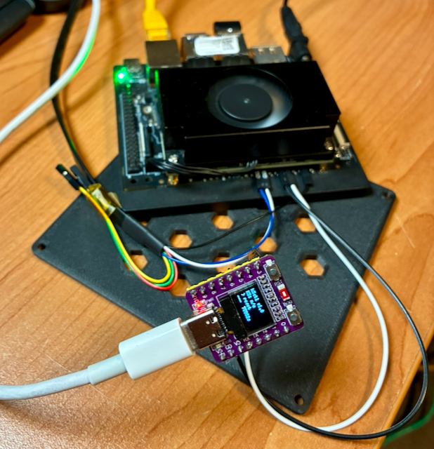

<!-- SPDX-License-Identifier: GPL-2.0-only -->

# k3ctl - USB button control for the K3-CoM260

An ESP32-C3 dongle implements header-button sequences for a **K3-CoM260 on
the Firefly carrier**, controlled from a Linux workstation over USB. The
dongle handles timing; the Python client sends a command and reports its reply.

**Hardware status: reset and power-button control are maintainer-reported as
working.** The power-button result and pins 5/6 restriction were reported on
2026-10-30; see [recorded hardware results](#recorded-hardware-results).
Other commands, recovery entry, power sensing, and display behavior remain
unverified. The carrier PCB revision, K3 firmware/OS versions, and ESP32 build
versions were not recorded for these results; the reset test date is also
unrecorded. The firmware source reports protocol version `1.0`; this does not
identify the builds used for either result.

**Reset abruptly restarts the K3 and can lose unsaved data.** An `OK` reply
acknowledges a firmware command, not a verified K3 boot or power-state change.
Do not issue board-control commands as unattended contribution checks.

This tool is standalone. `k3-flash-bianbu.sh` does **not** call it and has
**no `-r` option**. Use the existing
[manual recovery instructions](../README.md#putting-the-board-in-recovery)
for factory flashing; USB recovery automation is not an established result.

## Bundle and requirements

| Path | Purpose |
| --- | --- |
| [`k3ctl`](k3ctl) | Standard-library-only Python client; Linux, Python 3.10+ |
| [`firmware/k3ctl/k3ctl.ino`](firmware/k3ctl/k3ctl.ino) | ESP32-C3 firmware; arduino-esp32 core 3.x, U8g2 when the OLED is enabled |
| [`99-k3ctl.rules`](99-k3ctl.rules) | Optional Linux udev rule for `/dev/k3ctl` and port permissions |
| [`tests/test_k3ctl.py`](tests/test_k3ctl.py) | Hardware-free client tests using a pseudo-terminal |

Run the commands below from `tools/k3ctl/`; from the repository root:

```sh
cd tools/k3ctl
```

## Hardware

The firmware's intended dongle is the
[**ABRobot "ESP32-C3 0.42 OLED"**](https://github.com/zhuhai-esp/ESP32-C3-ABrobot-OLED).
Its source configures a 72x40 SSD1306 on GPIO5/6 and native USB CDC.
`-DK3CTL_OLED=0` provides a no-display build option; other ESP32-C3 boards
and that build variant have not been validated here.

Thanks to **Kevin of Kevin's Blog** for the board-specific information
used here. His
[ESP32-C3 0.42 OLED article](https://emalliab.wordpress.com/2025/02/12/esp32-c3-0-42-oled/)
(February 12, 2025) documents the pinout investigation, OLED wiring, USB CDC
setup and onboard LED behavior, and links to the
[board schematic](https://github.com/zhuhai-esp/ESP32-C3-ABrobot-OLED/blob/main/Document/ESP32C3%20OLED%E5%8E%9F%E7%90%86%E5%9B%BE.pdf).
These sources concern the ESP32-C3 dongle, not the K3 header wiring or the
reset result above.



The maintainer's setup. The photo is for identification, not a wiring diagram
or evidence that the untested functions work.

**Match the actual carrier's numbering, orientation, ground and signals
before wiring.** The
[conditional header reference](../../wiki/Console-and-Recovery.md#conditional-12-pin-header-reference)
explains the Firefly scope and the vendor reference-kit guide. This is not
a universal K3-CoM260 pinout; do not apply it to another carrier by inference.
For power-button control, **leave K3 header pins 5 and 6 unbridged**; see the
[recorded restriction](#recorded-hardware-results). Power sensing remains
untested design guidance.

| ESP32-C3 | Connection | Matching Firefly 12-pin header | Function / status |
|---|---|---|---|
| GPIO3 | Pull low / release | pin 8, `PMIC_RST_OUTn` / `RST` | Reset; maintainer-reported working |
| GPIO4 | Pull low / release | pin 10, `FORCE_RECOVERY` / `FC_REC` | Recovery; untested |
| GPIO7 | Pull low / release | pin 12, `SLEEP/WAKE` | Power button; maintainer-reported working with header pins 5/6 unbridged |
| GND | Common ground | confirmed GND, pin 9 (7 or 11 in the matching reference) | Control-signal return |
| GPIO10 | Via optional sensing circuit only | pins 2 / 1, `PC_LED+` / `PC_LED-` | Power sensing; untested, disabled by default |

The firmware emulates open-drain control: released pins are inputs (Hi-Z),
and asserted pins drive low, never deliberately high. This does **not**
establish voltage compatibility or immunity to startup glitches/back-feed.
Verify the actual electrical levels and dongle pinout before connecting;
do not assume an undocumented PMIC voltage is safe.

Power the dongle from the **workstation USB only**, never from the K3 header.
Program it before wiring; disconnect the header control wires before later
dongle uploads or resets because those transitions have not been validated.
Start with confirmed ground and the reset line only; leave untested control
and sense lines disconnected until a deliberate attended test.

GPIO2/8/9 are not header-control outputs; GPIO8 is used only for the dongle's
local LED. GPIO5/6 are reserved for the OLED, 18/19 for USB, and 20/21 for
UART0. Keep the K3 serial console on a separate **3.3 V USB-TTL adapter**,
connected to the matched RX, TX and ground only, with its VCC lead disconnected.

### Recorded hardware results

The maintainer previously reported `reset` working; its test date was not
recorded. On **2026-10-30**, the maintainer reported that the power-button pin
was connected and verified working. **With K3 header pins 5 and 6 shorted
together, the board did not power back on via the power-button pin.** Leave
those two pins unbridged for this Firefly-carrier setup.

The [SpacemiT reference-kit guide V2.1, section 5.3](https://cdn-resource.spacemit.com/file/product/K3/k3_com260_ug_en.pdf)
describes bridging pin 5 (`BMCU_ACOK`) and pin 6 (`AUTO_ON_DIS`) to enable
button power-on. That guidance does not match the reported behavior; the
reason remains unresolved. This observation is not a proven correction for
every carrier or firmware version.

The exact command and pulse duration used for the power test were not
recorded. This establishes the reported pin function, not validation of every
`power`, `press` or `hold` variant or timing.

### Optional power sense - untested

Power sensing is **off by default** (`K3_SENSE_PIN=-1`), so `status` reports
`k3=n/a`. Treat `PC_LED+` as a potentially **5 V** signal: never connect it
directly to an ESP32-C3 GPIO. Confirm the header's voltage and switching
behavior before choosing a sensing circuit. Neither option below was tested:

- **Optocoupler:** `-DK3_SENSE_PIN=10` selects the default inverted input.
  The proposed PC817 input is anode to pin 2 through 1 kohm and cathode to
  pin 1; its output is emitter to ESP GND and collector to GPIO10 with the
  firmware's internal pull-up. LOW is interpreted as K3 on. Confirm the
  header can drive the optocoupler before using it.
- **Divider:** `-DK3_SENSE_PIN=10 -DK3_SENSE_INVERT=0` interprets HIGH as on.
  The proposed 10 kohm from pin 2 to GPIO10 and 15 kohm from GPIO10 to GND
  gives nominally 3.0 V for a 5 V input. It is suitable only if pin 2 itself
  tracks on/off with the PSU connected and measured levels are safe; it
  cannot detect power if the board switches only the `PC_LED-` side.

The control wires share ground, so the complete dongle is **not galvanically
isolated**, even if an optocoupler is used for the optional sense input.

## Firmware

The build instructions are setup guidance, **not a recorded reproducer of
either hardware result**. Install Arduino CLI, a reviewed **3.x** release of the
`esp32:esp32` core using the
[official Espressif package index](https://docs.espressif.com/projects/arduino-esp32/en/latest/installing.html),
and U8g2 for the default OLED build. Exact core/library versions are not
pinned or recorded as tested; record them when performing a new test.

```sh
arduino-cli core list
arduino-cli lib list
FQBN=esp32:esp32:esp32c3:CDCOnBoot=cdc,FlashSize=4M
arduino-cli compile --fqbn "$FQBN" firmware/k3ctl
```

`CDCOnBoot=cdc` selects USB CDC for `Serial`. Build-time options go in
`--build-property "build.extra_flags=-DK3CTL_OLED=0"`; combine any power-sense
flags in that same property rather than supplying it multiple times.

Upload only to the **verified dongle port**, with all K3 header wires
disconnected. For the initial upload, the intended board enters ROM download
mode by holding BOOT while plugging in USB, then releasing it; match the
actual board's instructions. `/dev/ttyACM0` below is an example, not a device
selection rule:

```sh
arduino-cli upload --fqbn "$FQBN" -p /dev/ttyACM0 firmware/k3ctl
```

## Linux host setup

The client can run directly from the checkout. Its local help does not open
a device:

```sh
./k3ctl --help
```

The udev rule is optional; `-d /dev/ttyACM0` or `K3CTL_DEV` can select a
verified port instead. The supplied rule matches an Espressif USB ID, not a
unique dongle. **Before installing it, pin it to the dongle's serial if other
matching devices are connected**; the rule's comments explain how to obtain
that serial. Otherwise `/dev/k3ctl` may select the wrong device.

After reviewing the rule:

```sh
sudo install -m 0644 99-k3ctl.rules /etc/udev/rules.d/99-k3ctl.rules
sudo udevadm control --reload-rules
sudo udevadm trigger --subsystem-match=tty
ls -l /dev/k3ctl
```

Ensure the account has serial-port access; the rule uses group `dialout`.
Group membership changes require a new login. Keep another serial reader
off the dongle's port; the K3 console uses the separate adapter.

After confirming the dongle identity, wiring, and permission to interrupt
the K3, the maintainer-tested command is:

```sh
./k3ctl reset
# Without the udev symlink, after verifying the actual device:
./k3ctl -d /dev/ttyACM0 reset
```

These are alternative invocations, not a two-reset procedure. The client
locks the port with `flock`, sets raw serial mode with `HUPCL` off, and pings
before sending the requested command. The handshake is part of `reset`;
it does not establish a separate hardware result for the `ping` command.

Exit status is `0` for an `OK` reply, `1` for `ERR`, and `2` for device,
communication or usage errors. `-q` suppresses successful output; `-t`
sets the reply timeout. Explicit `power`/`press` durations extend the
timeout to accommodate the requested pulse.

## Protocol and command coverage

One nonblank ASCII command line produces an `OK` or `ERR` reply; blank
lines are ignored. The sequences below describe the **source implementation**,
not evidence that every command or timing has been tested. The recorded
hardware results cover reset and the power-button pin only.
`status` line flags describe firmware-held outputs, not electrical measurements.

| command | effect | reply |
|---|---|---|
| `ping` | — | `OK pong k3ctl 1.0` |
| `status` | — | `OK status rst=0 fcrec=0 pwr=0 k3=on\|off\|n/a up=<ms> ver=1.0` |
| `reset` | RST low 200 ms | `OK reset` |
| `recovery` | FC_REC low, wait 300 ms, RST low 200 ms, wait 500 ms, release FC_REC | `OK recovery` |
| `power [ms]` | SLEEP/WAKE low for *ms* (default 300) | `OK power 300` |
| `press <rst\|fcrec\|pwr> [ms]` | that line low for *ms* (default 200, max 15000) | `OK press fcrec 200` |
| `hold <line>` | assert; requests auto-release after 30 s, subject to loop servicing | `OK hold fcrec (auto-release in 30 s)` |
| `release <line>\|all` | release | `OK release fcrec` |
| `help` | — | `OK help …` |

`./k3ctl help` contacts the dongle, unlike local `./k3ctl --help`.
`raw '<line>'` sends a verbatim protocol line and bypasses the client's
duration/arity checks; it is not needed for normal reset use.

## Known limits

The `hold` release timer is checked in the main loop, between synchronous
command handlers. Blocking commands can delay that check; it is **not an
independent 30-second hardware failsafe**. Host disconnects, dongle reset,
startup transients and arbitrary command combinations have not been
validated. Keep physical reset/power access and an attended serial console.

The OLED/LED code is intended to display power state, last action, held-line
flags and uptime. It has no separate recorded hardware result. No-display
builds and the optional sensing circuits also remain untested.

## Hardware-free validation

```sh
python3 -B tests/test_k3ctl.py
```

The tests exercise the Python client against a fake dongle on a
pseudo-terminal, including replies, usage errors, missing/silent devices,
and a dropped initial ping. They do not run the ESP32 firmware or establish
K3 recovery, power, display, electrical safety or hardware timing results.

Further hardware results need an attended test recording the module/carrier,
K3 firmware/OS, exact ESP32 source/build and dependency versions, date,
commands, observed outcome and failures. Do not promote an `OK` reply or a
host test into a hardware result.

## License and assistance

GPL-2.0-only; see the repository [LICENSE](../../LICENSE).

The initial implementation was prepared with **Claude Fable 5.1**, as
reported by the maintainer. Repository integration, licensing headers and
documentation were assisted by **GitHub Copilot CLI**. The human contributor
remains responsible for reviewing and understanding the contribution,
provenance and publication under the [LLM policy](../../LLM-POLICY.md).
