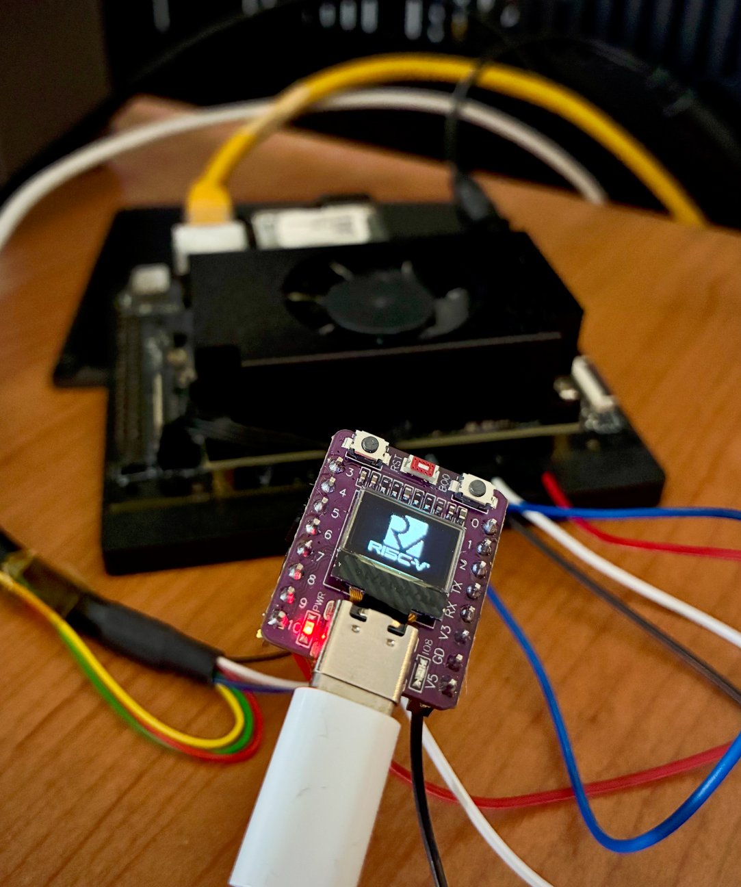

<!-- SPDX-License-Identifier: GPL-2.0-only -->

# k3ctl - USB button control for the K3-CoM260

An ESP32-C3 dongle implements header-button sequences for a **K3-CoM260 on
the Firefly carrier**, controlled from a Linux workstation over USB. The
dongle handles timing; the Python client sends a command and reports its reply.

**Hardware status: reset is maintainer-reported working. With pins 5/6
bridged, a 300 ms press powered on after DC insertion or forced power-off,
but not after software shutdown; a 12 s hold cut power abruptly.**
Removing/reconnecting DC followed by 300 ms restored power-on after the
software-shutdown failure. Earlier failures with both jumper configurations
remain recorded; see [recorded hardware results](#recorded-hardware-results).
Recovery entry, power sensing, named power modes, the optional DC switch
and LED remain unverified. The observed version 1.1 logo and `ERR`
display and version 1.1.1 logo screensaver are described under
[Display](#display). The carrier
PCB revision was not recorded for any result, and the earlier results also
lack K3 firmware/OS and ESP32 build versions. The firmware source now reports
protocol version `1.1.1`; the earlier power-control results used firmware `1.0`.

**Reset abruptly restarts the K3 and can lose unsaved data.** An `OK` reply
acknowledges a firmware command, not a verified K3 boot or power-state change.
Do not issue board-control commands as unattended contribution checks.

This tool is standalone. `k3-flash-bianbu.sh` does **not** call it and has
**no `-r` option**. Use the existing
[manual recovery instructions](../README.md#putting-the-board-in-recovery)
for factory flashing; USB recovery automation is not an established result.

## Bundle and requirements

| Path | Purpose |
| --- | --- |
| [`k3ctl`](k3ctl) | Standard-library-only Python client; Linux, Python 3.10+ |
| [`firmware/k3ctl/k3ctl.ino`](firmware/k3ctl/k3ctl.ino) | ESP32-C3 firmware; arduino-esp32 core 3.x, U8g2 when the OLED is enabled |
| [`firmware/k3ctl/riscv_logo.h`](firmware/k3ctl/riscv_logo.h) | Generated 1-bit RISC-V logo for the OLED; see [Display](#display) |
| [`make-logo.py`](make-logo.py) | Regenerates `riscv_logo.h` from the official logo pack; needs Pillow |
| [`99-k3ctl.rules`](99-k3ctl.rules) | Optional Linux udev rule for `/dev/k3ctl` and port permissions |
| [`tests/test_k3ctl.py`](tests/test_k3ctl.py) | Hardware-free client tests using a pseudo-terminal |

Run the commands below from `tools/k3ctl/`; from the repository root:

```sh
cd tools/k3ctl
```

## Hardware

The firmware's intended dongle is the
[**ABRobot "ESP32-C3 0.42 OLED"**](https://github.com/zhuhai-esp/ESP32-C3-ABrobot-OLED).
Its source configures a 72x40 SSD1306 on GPIO5/6 and native USB CDC.
`-DK3CTL_OLED=0` provides a no-display build option; other ESP32-C3 boards
and that build variant have not been validated here.

Thanks to **Kevin of Kevin's Blog** for the board-specific information
used here. His
[ESP32-C3 0.42 OLED article](https://emalliab.wordpress.com/2025/02/12/esp32-c3-0-42-oled/)
(February 12, 2025) documents the pinout investigation, OLED wiring, USB CDC
setup and onboard LED behavior, and links to the
[board schematic](https://github.com/zhuhai-esp/ESP32-C3-ABrobot-OLED/blob/main/Document/ESP32C3%20OLED%E5%8E%9F%E7%90%86%E5%9B%BE.pdf).
These sources concern the ESP32-C3 dongle, not the K3 header wiring or the
reset result above.



The maintainer's setup, showing the RISC-V logo on the dongle. The photo is
for identification, not a wiring diagram or evidence that the untested
functions work.

**Match the actual carrier's numbering, orientation, ground and signals
before wiring.** The
[conditional header reference](../../wiki/Console-and-Recovery.md#conditional-12-pin-header-reference)
explains the Firefly scope and the vendor reference-kit guide. This is not
a universal K3-CoM260 pinout; do not apply it to another carrier by inference.
Choose the pins **5/6** jumper configuration from the
[recorded results](#recorded-hardware-results), not a blanket power-on
assumption: unbridged DC insertion auto-booted in October; bridged DC
insertion stayed off and a 300 ms press started it in November, but waking
after software shutdown still failed. Disconnect DC before changing the
jumper. Power sensing remains untested design guidance.

| ESP32-C3 | Connection | Matching Firefly 12-pin header | Function / status |
|---|---|---|---|
| GPIO3 | Pull low / release | pin 8, `PMIC_RST_OUTn` / `RST` | Reset; maintainer-reported working |
| GPIO4 | Pull low / release | pin 10, `FORCE_RECOVERY` / `FC_REC` | Recovery; untested |
| GPIO7 | Pull low / release | pin 12, `SLEEP/WAKE` | Power button; bridged 300 ms power-on worked in specific off states; 12 s forced power-off; software-shutdown wake unresolved |
| GND | Common ground | confirmed GND, pin 9 (7 or 11 in the matching reference) | Control-signal return |
| GPIO10 | Via optional sensing circuit only | pins 2 / 1, `PC_LED+` / `PC_LED-` | Power sensing; untested, disabled by default |
| GPIO0 | Optional external LED + resistor to GND | none (dongle side only) | Status LED; untested, disabled by default |
| GPIO1 | Optional DC-switch module logic input | none (switches the K3 DC input) | `power cycle`; untested, disabled by default |

The firmware emulates open-drain control: released pins are inputs (Hi-Z),
and asserted pins drive low, never deliberately high. This does **not**
establish voltage compatibility or immunity to startup glitches/back-feed.
Verify the actual electrical levels and dongle pinout before connecting;
do not assume an undocumented PMIC voltage is safe.

Power the dongle from the **workstation USB only**, never from the K3 header.
Program it before wiring; disconnect the header control wires before later
dongle uploads or resets because those transitions have not been validated.
Start with confirmed ground and the reset line only; leave untested control
and sense lines disconnected until a deliberate attended test.

GPIO2/8/9 are not header-control outputs; GPIO8 is used only for the dongle's
local LED. GPIO5/6 are reserved for the OLED, 18/19 for USB, and 20/21 for
UART0. Keep the K3 serial console on a separate **3.3 V USB-TTL adapter**,
connected to the matched RX, TX and ground only, with its VCC lead disconnected.

### Recorded hardware results

The maintainer previously reported `reset` working; its test date was not
recorded. On **2026-10-30**, the maintainer reported that the power-button pin
was connected and verified working. **With K3 header pins 5 and 6 shorted
together, the board did not power back on via the power-button pin.**
The exact command and pulse duration were not recorded. This earlier
failure is retained alongside the later successful bridged test below.

The [SpacemiT reference-kit guide V2.1, section 5.3](https://cdn-resource.spacemit.com/file/product/K3/k3_com260_ug_en.pdf)
describes bridging pin 5 (`BMCU_ACOK`) and pin 6 (`AUTO_ON_DIS`) to enable
button power-on. The November test demonstrates button power-on with that
bridge in some off states, but not after software shutdown. The reasons
for that failure and the October bridged failure remain unresolved; this
is not a proven configuration for every carrier or firmware version.

On **2026-10-31** (21:31-21:41 UTC), with the maintainer present, an attended
test used k3ctl firmware `1.0` with power sensing not wired (`k3=n/a`) and
pins 5/6 **unbridged**. The K3 was running Fedora 45 kernel
`7.3.0-65.1.riscv64.omni.fc45`. After a software `poweroff`, `k3ctl power` at
300, 1000, 3000, 6000 and 12000 ms, then one `k3ctl reset`, were each
acknowledged. None produced any K3 serial console output within 25-30 s.
The board came back only when DC power was unplugged and replugged, then
booted to Fedora. No physical power button is attached to the carrier. On
2026-11-01 the maintainer reported that a `power` tap powers off a running
Fedora 45 board; the duration used is unrecorded.

On **November 6-7, 2026 (operator local time, UTC-08:00)**, an attended
test on the same K3-CoM260/Firefly setup used firmware **1.1**, Arduino CLI
1.5.1, ESP32 core 3.3.12 and U8g2 2.36.19, built for
`esp32:esp32:esp32c3:CDCOnBoot=cdc,FlashSize=4M`. Power sensing was not wired
(`k3=n/a`); the current K3 firmware, OS/kernel revision and carrier PCB
revision were not freshly established. Console and power outcomes below
were observed and reported by the maintainer, not inferred from replies.
DC was disconnected before fitting the pins **5/6 bridge**, which remained
fitted throughout this sequence:

| Condition / command | Observed result |
| --- | --- |
| Reconnect DC with the bridge fitted | Stayed off |
| `power 300` after DC insertion | Powered on; console output appeared |
| While running: `power 300`, `power 1000`, repeated `power 3000`, `power 6000` | Stayed on |
| While running: `power 12000` | Power disappeared abruptly |
| `power 300` after that forced power-off | Powered on again |
| After boot, maintainer ran `sudo poweroff` in the K3 console | Powered off |
| `power 300` after software shutdown, with DC still connected | Stayed off; no console output |
| Remove/reconnect DC, then `power 300` | Powered on; console output appeared |

Each pulse returned the corresponding `OK power <ms>` reply. The outcome
of the first 3-second press was not established, so it was repeated; the
repeat left the K3 on. The 12-second hold was **forced power loss**, not
clean OS shutdown. The exact forced-off threshold is not established.

**Still unresolved:** waking from software shutdown without removing DC,
the electrical/firmware reason for the different off states, and broader
repeatability. These tests used explicit pulse lengths: named `power on`,
`power off` and `power force-off` were not validated. Their unchanged
defaults (1000 ms, 300 ms and 10000 ms) are not equivalent to the two
successful 300 ms power-on / 12000 ms forced-off actions.
The optional [DC switch](#optional-dc-switch---untested) remains an unbuilt,
untested fallback; do not equate the manual DC-cycle result with its safety
or operation.

### Optional power sense - untested

Power sensing is **off by default** (`K3_SENSE_PIN=-1`), so `status` reports
`k3=n/a`. Treat `PC_LED+` as a potentially **5 V** signal: never connect it
directly to an ESP32-C3 GPIO. Confirm the header's voltage and switching
behavior before choosing a sensing circuit. Neither option below was tested:

- **Optocoupler:** `-DK3_SENSE_PIN=10` selects the default inverted input.
  The proposed PC817 input is anode to pin 2 through 1 kohm and cathode to
  pin 1; its output is emitter to ESP GND and collector to GPIO10 with the
  firmware's internal pull-up. LOW is interpreted as K3 on. Confirm the
  header can drive the optocoupler before using it.
- **Divider:** `-DK3_SENSE_PIN=10 -DK3_SENSE_INVERT=0` interprets HIGH as on.
  The proposed 10 kohm from pin 2 to GPIO10 and 15 kohm from GPIO10 to GND
  gives nominally 3.0 V for a 5 V input. It is suitable only if pin 2 itself
  tracks on/off with the PSU connected and measured levels are safe; it
  cannot detect power if the board switches only the `PC_LED-` side.

The control wires share ground, so the complete dongle is **not galvanically
isolated**, even if an optocoupler is used for the optional sense input.

With sensing enabled, `power on` and `power off` skip the press when the
sensed state already matches, `power on` waits up to 5 s for the K3 to read
as on, and `power force-off` releases early once the K3 reads off.

### Optional status LED - untested

The ABRobot dongle's only firmware-controlled on-board LED listed in the
sources above is the blue GPIO8 LED, which k3ctl already lights while it
drives a line. `-DK3CTL_EXTLED_PIN=0` drives an external LED
(with a series resistor, for example 1 kohm, to GND) from GPIO0. It is lit
while the K3 is sensed on or an event is showing on the OLED.

### Optional DC switch - untested

`-DK3CTL_DCSW_PIN=1` enables `power cycle [ms]`, which drives GPIO1 to cut
the K3's DC input for *ms* (default 3000), then restores it. This relies on
the [recorded](#recorded-hardware-results) auto-boot when DC is reapplied
with pins 5/6 unbridged; it has not been built into hardware or tested.

- Use a module with a **3.3 V logic input** (relay module with its own
  driver, or a logic-level MOSFET/load switch rated for the K3 supply). Never
  drive a relay coil or the K3 supply from the GPIO directly.
- Wire the switched contact so DC stays **on** when the dongle is unpowered
  or resetting (for example a relay's normally-closed contact).
- `K3CTL_DCSW_CUT_LEVEL` (default `1`) is the GPIO level that cuts power;
  set it to match the module. Startup glitches on GPIO1 are unverified.
- Cutting DC is an abrupt power loss: it can lose data like `reset`.

## Display

The firmware drives the 72x40 OLED with large text instead of the version
1.0 status lines:

| Situation | Screen |
| --- | --- |
| Dongle power-up | RISC-V logo for 3 s |
| Command or detected event | 3 s large word: `PWR`, `RST`, `REC`, `ON`, `OFF`, `DC`, `ERR`; small second line such as `on`, `press` or `ext` |
| Any line held by `hold` | `HOLD` and the held line names, until released |
| Idle, K3 sensed on | `ON` |
| Idle, K3 sensed off or sensing disabled | RISC-V logo (standby) |

Events stay up for 3 s after a long press ends. In firmware **1.1.1**, the
logo starts centred at full brightness. After 10 s from startup, it dims
and bounces horizontally at one pixel per second, staying fully on-screen.
The same screensaver applies to `ON` when power sensing is enabled.
Events and `HOLD` stay bright and centred; returning to idle starts a new
10-second bright period before dimming and movement resume.
`-DK3CTL_EVENT_MS=` and `-DK3CTL_LOGO_MS=` change the event and boot-logo
timings.

On November 6, 2026 (operator local time, UTC-08:00), the maintainer observed
the firmware 1.1 startup/idle logo and confirmed a large `ERR` event was
readable and returned to the logo on the ABRobot dongle. That build used
ESP32 core 3.3.12 and U8g2 2.36.19, with power sensing disabled.

On November 7, 2026 (operator local time, UTC-08:00), firmware 1.1.1 was
uploaded with the K3 header wires disconnected, using the same core and
library versions. The maintainer confirmed the logo started bright,
then dimmed and moved without clipping. A harmless unknown-command `ERR`
event was also confirmed to return to a bright centred logo for about
10 seconds before dimming and movement resumed. Power sensing remained
disabled; the `ON` screensaver has compile/native-test coverage but no
hardware observation.

The logo is RISC-V International's official stacked white logo, scaled
and thresholded to 51x40 pixels by [`make-logo.py`](make-logo.py) from the
published logo pack (its URL and SHA-256 are pinned in the script and the
generated header). The RISC-V name and logo are trademarks of RISC-V
International; its [brand guidelines](https://riscv.org/about/brand-guidelines/)
permit their use for non-commercial projects that follow those guidelines.
The repository license grants no trademark rights. To regenerate:

```sh
python3 -B make-logo.py
```

### Line monitoring - untested

With `K3CTL_MONITOR=1` (default) the firmware also reads the released
pin 12 (`SLEEP/WAKE`) and pin 8 (`PMIC_RST_OUTn`) lines. A low pulse of
at least 30 ms after 500 ms high that k3ctl did not cause shows `PWR` or
`RST` with `ext`, for example from a carrier button or a K3-initiated reset.
It only reads the existing connections, but the signals' behavior is unknown.
A floating line while the K3 is off could cause false events;
`-DK3CTL_MONITOR=0` disables monitoring. `status` reports the current input
levels as `inpwr`/`inrst` (`-` while k3ctl drives the line) and the last
event as `ev`; these are logic readings, not voltage measurements.

## Firmware

The build instructions are setup guidance, **not a recorded reproducer of
either hardware result**. Install Arduino CLI, a reviewed **3.x** release of the
`esp32:esp32` core using the
[official Espressif package index](https://docs.espressif.com/projects/arduino-esp32/en/latest/installing.html),
and U8g2 for the default OLED build. Exact core/library versions are not
pinned or recorded as tested; record them when performing a new test.

```sh
arduino-cli core list
arduino-cli lib list
FQBN=esp32:esp32:esp32c3:CDCOnBoot=cdc,FlashSize=4M
arduino-cli compile --fqbn "$FQBN" firmware/k3ctl
```

`CDCOnBoot=cdc` selects USB CDC for `Serial`. Build-time options go in
`--build-property "build.defines=-DK3CTL_OLED=0"`; combine several flags in
that one property, for example
`"build.defines=-DK3_SENSE_PIN=10 -DK3CTL_EXTLED_PIN=0"`. **Do not override
`build.extra_flags`:** in esp32 core 3.3.12 it carries
`-DARDUINO_USB_CDC_ON_BOOT=1`, so replacing it would drop USB serial.

Upload only to the **verified dongle port**, with all K3 header wires
disconnected. For the initial upload, the intended board enters ROM download
mode by holding BOOT while plugging in USB, then releasing it; match the
actual board's instructions. `/dev/ttyACM0` below is an example, not a device
selection rule:

```sh
arduino-cli upload --fqbn "$FQBN" -p /dev/ttyACM0 firmware/k3ctl
```

## Linux host setup

The client can run directly from the checkout. Its local help does not open
a device:

```sh
./k3ctl --help
```

The udev rule is optional; `-d /dev/ttyACM0` or `K3CTL_DEV` can select a
verified port instead. The supplied rule matches an Espressif USB ID, not a
unique dongle. **Before installing it, pin it to the dongle's serial if other
matching devices are connected**; the rule's comments explain how to obtain
that serial. Otherwise `/dev/k3ctl` may select the wrong device.

After reviewing the rule:

```sh
sudo install -m 0644 99-k3ctl.rules /etc/udev/rules.d/99-k3ctl.rules
sudo udevadm control --reload-rules
sudo udevadm trigger --subsystem-match=tty
ls -l /dev/k3ctl
```

Ensure the account has serial-port access; the rule uses group `dialout`.
Group membership changes require a new login. Keep another serial reader
off the dongle's port; the K3 console uses the separate adapter.

After confirming the dongle identity, wiring, and permission to interrupt
the K3, the maintainer-tested command is:

```sh
./k3ctl reset
# Without the udev symlink, after verifying the actual device:
./k3ctl -d /dev/ttyACM0 reset
```

These are alternative invocations, not a two-reset procedure. The client
locks the port with `flock`, sets raw serial mode with `HUPCL` off, and pings
before sending the requested command. The handshake is part of `reset`;
it does not establish a separate hardware result for the `ping` command.

Exit status is `0` for an `OK` reply, `1` for `ERR`, and `2` for device,
communication or usage errors. `-q` suppresses successful output; `-t`
sets the reply timeout. Explicit `power`/`press` durations extend the
timeout to accommodate the requested pulse.

## Protocol and command coverage

One nonblank ASCII command line produces an `OK` or `ERR` reply; blank
lines are ignored. The sequences below describe the **source implementation**,
not evidence that every command or timing has been tested. The recorded
hardware results cover firmware 1.0 reset and power-button-pin behavior only;
no tested `power on` duration exists. `status` line flags describe
firmware-held outputs, not electrical measurements. The client waits up to
12 s for `power on`, 15 s for `power force-off` and *ms* + 3 s for
`power cycle`; a longer `-t` overrides these.

| command | effect | reply |
|---|---|---|
| `ping` | — | `OK pong k3ctl 1.1.1` |
| `status` | — | `OK status rst=0 fcrec=0 pwr=0 k3=on\|off\|n/a up=<ms> ver=1.1.1 inpwr=1 inrst=1 ev=PWR` |
| `reset` | RST low 200 ms | `OK reset` |
| `recovery` | FC_REC low, wait 300 ms, RST low 200 ms, wait 500 ms, release FC_REC | `OK recovery` |
| `power [ms]` | SLEEP/WAKE low for *ms* (default 300) | `OK power 300` |
| `power on` | unless sensed on: SLEEP/WAKE low 1000 ms (`K3CTL_PWR_ON_MS`), then wait up to 5 s for sense | `OK power on k3=on\|n/a`; `ERR power on: k3 still off` |
| `power off` | unless sensed off: SLEEP/WAKE low 300 ms | `OK power off k3=<state>` |
| `power force-off` | SLEEP/WAKE low up to 10 s (`K3CTL_PWR_FORCE_MS`), released early once sensed off | `OK power force-off <ms> k3=<state>` |
| `power cycle [ms]` | optional DC switch cuts power for *ms* (default 3000) | `OK power cycle 3000`; `ERR` if not built in |
| `press <rst\|fcrec\|pwr> [ms]` | that line low for *ms* (default 200, max 15000) | `OK press fcrec 200` |
| `hold <line>` | assert; requests auto-release after 30 s, subject to loop servicing | `OK hold fcrec (auto-release in 30 s)` |
| `release <line>\|all` | release | `OK release fcrec` |
| `help` | — | `OK help …` |

`./k3ctl help` contacts the dongle, unlike local `./k3ctl --help`.
`raw '<line>'` sends a verbatim protocol line and bypasses the client's
duration/arity checks; it is not needed for normal reset use.

## Known limits

The `hold` release timer is checked by the firmware loop, including during
the waits inside blocking commands, but it is still software: it is **not
an independent 30-second hardware failsafe**. Host disconnects, dongle reset,
startup transients and arbitrary command combinations have not been
validated. Keep physical reset/power access and an attended serial console.

The OLED, line monitoring, external LED and DC-switch code compile but have
no recorded hardware result. No-display builds and the optional sensing
circuits also remain untested.

## Hardware-free validation

```sh
python3 -B tests/test_k3ctl.py
```

The tests exercise the Python client against a fake dongle on a
pseudo-terminal, including replies, usage errors, missing/silent devices,
a dropped initial ping, and the `power on|off|force-off|cycle` argument
forms. They do not run the ESP32 firmware or establish
K3 recovery, power, display, electrical safety or hardware timing results.

Further hardware results need an attended test recording the module/carrier,
K3 firmware/OS, exact ESP32 source/build and dependency versions, date,
commands, observed outcome and failures. Do not promote an `OK` reply or a
host test into a hardware result.

## License and assistance

GPL-2.0-only; see the repository [LICENSE](../../LICENSE).

The initial implementation was prepared with **Claude Fable 5.1**, as
reported by the maintainer. Repository integration, licensing headers and
documentation were assisted by **GitHub Copilot CLI**, as were the
version 1.1 firmware (display, logo, line monitoring and power commands),
the 1.1.1 screensaver update,
`make-logo.py` and related client changes. The human contributor
remains responsible for reviewing and understanding the contribution,
provenance and publication under the [LLM policy](../../LLM-POLICY.md).
